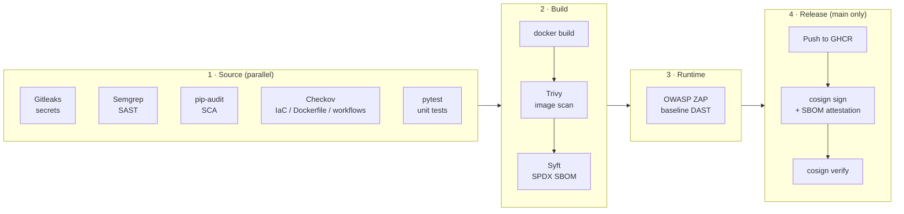

# secure-cicd-pipeline

[](https://github.com/Z-mac-debug/secure-cicd-pipeline/actions/workflows/pipeline.yml)

An end-to-end DevSecOps pipeline in GitHub Actions. Every commit passes secrets
detection, static analysis, dependency auditing and infrastructure-as-code checks,
then the container image is built, scanned, given an SBOM and attacked with a
dynamic scan before it ships. Only images that clear every gate are pushed to
GHCR and **signed keylessly with Sigstore cosign**, so anyone can verify where an
image came from and that nobody has altered it.

The workload is a deliberately small Flask API. The point of the repo is the
pipeline and the security decisions around it.

## Pipeline



| Stage | Tool | What it catches | Fails the build when |
|---|---|---|---|
| Secrets | **Gitleaks** | API keys, tokens and passwords anywhere in git history | any secret is found |
| SAST | **Semgrep** (`p/python`, `p/flask`, `p/owasp-top-ten`, `p/dockerfile`) | injection, insecure Flask config, risky code patterns | any finding |
| SCA | **pip-audit** | known CVEs in pinned Python dependencies (PyPI advisory DB / OSV) | any known vulnerability |
| IaC | **Checkov** | Terraform, Dockerfile and GitHub Actions misconfigurations | any failed check that isn't explicitly accepted |
| Tests | **pytest** | functional regressions, including security headers and input validation | any test fails |
| Image | **Trivy** | OS and library CVEs, secrets and misconfigurations in the built image | a fixable HIGH or CRITICAL vulnerability |
| SBOM | **Syft** (anchore/sbom-action) | produces an SPDX inventory of everything in the image | n/a (artefact) |
| DAST | **OWASP ZAP** baseline | missing security headers, info leaks and other runtime issues | any alert not explicitly ignored |
| Supply chain | **cosign** (keyless, GitHub OIDC) | tampering and provenance: proves this repo's workflow built the image | signing or verification fails |

Semgrep, Checkov and Trivy also publish SARIF to the GitHub **Security → Code
scanning** tab, so findings appear inline on pull requests.

## Security design decisions

- **What was tested is what ships.** The image is built once, saved, then reused
  by the DAST and release jobs. The release job pushes that exact image and
  signs it by **digest**, never by tag. There is no rebuild between scanning and
  release.
- **Actions pinned to commit SHAs.** Tags are mutable. In March 2026 attackers
  force-pushed 76 of 77 `aquasecurity/trivy-action` tags to credential-stealing
  code, which hit every workflow that referenced the action by tag. Every action
  here is pinned to a full SHA with the version in a comment, and Dependabot
  keeps the pins current.
- **Least-privilege tokens.** The workflow defaults to `contents: read`. Each
  job adds only what it needs: `security-events: write` for SARIF upload, and
  `packages: write` plus `id-token: write` only in the release job, which runs
  only on `main`.
- **No long-lived signing keys.** cosign uses GitHub's OIDC token to get a
  short-lived certificate from Sigstore Fulcio, and the signature is recorded in
  the Rekor transparency log. There are no keys to store, rotate or leak.
- **SBOM as a signed attestation.** The SPDX SBOM is attached to the image as a
  cosign attestation, so consumers can fetch it and trust that it describes
  this image.
- **Hardened runtime.** The image uses a multi-stage build, a slim base with
  security updates applied, and no pip at runtime. It runs as a non-root UID and
  has a `HEALTHCHECK`. In the DAST job the container runs read-only with all
  capabilities dropped and `no-new-privileges` set.
- **Hardened runners.** `step-security/harden-runner` audits outbound network
  traffic from every job, as a baseline before moving to a block-mode allow-list.
- **Documented risk acceptance.** Checkov exceptions are inline
  `#checkov:skip` comments that each give a reason (see `terraform/main.tf`),
  and ZAP rules are tuned in `.zap/rules.tsv`. Nothing is suppressed silently.

## Verify a released image

```bash
IMAGE=ghcr.io/z-mac-debug/secure-cicd-pipeline
DIGEST=sha256:...   # from the "Push & sign" job summary

cosign verify "$IMAGE@$DIGEST" \
  --certificate-identity "https://github.com/Z-mac-debug/secure-cicd-pipeline/.github/workflows/pipeline.yml@refs/heads/main" \
  --certificate-oidc-issuer https://token.actions.githubusercontent.com

# Fetch and check the signed SBOM
cosign verify-attestation "$IMAGE@$DIGEST" --type spdxjson \
  --certificate-identity "https://github.com/Z-mac-debug/secure-cicd-pipeline/.github/workflows/pipeline.yml@refs/heads/main" \
  --certificate-oidc-issuer https://token.actions.githubusercontent.com \
  | jq -r '.payload' | base64 -d | jq '.predicate.packages | length'
```

In Kubernetes, the same identity constraint can be enforced at admission time
with the Sigstore policy-controller or Kyverno's `verifyImages` rule.

## Repository layout

```
.github/
  workflows/pipeline.yml   # the pipeline
  dependabot.yml           # keeps actions, pip, Docker and Terraform pins current
app/                       # Flask API (the workload)
tests/                     # pytest suite, including security-header tests
terraform/                 # hardened S3 + KMS example scanned by Checkov
.zap/rules.tsv             # ZAP baseline rule tuning
.gitleaks.toml             # Gitleaks config (default rules + allow-list)
Dockerfile                 # multi-stage, non-root, health-checked
```

## Run locally

```bash
python -m venv .venv && source .venv/bin/activate
pip install -r requirements-dev.txt
pytest -q
flask --app app.main run --port 8080

# or the container
docker build -t secure-cicd-pipeline:dev .
docker run --rm -p 8080:8080 --read-only --cap-drop ALL secure-cicd-pipeline:dev
curl "http://localhost:8080/api/greet?name=Ada"
```

The same scanners also run locally, for example `gitleaks git .`,
`semgrep scan --config p/python`, `pip-audit -r app/requirements.txt`,
`checkov -d .` and `trivy image secure-cicd-pipeline:dev`.

## Notes

- **Code scanning on private repos** needs GitHub Advanced Security. Without it
  the SARIF uploads are skipped (`continue-on-error`) but every gate still
  enforces. Making the repo public turns the Security tab on for free.
- **Public verification** of the signed image also requires the GHCR package
  to be public.

## Roadmap

- SLSA build provenance (`actions/attest-build-provenance`)
- Switch `harden-runner` from audit to a block-mode egress allow-list
- Hash-pinned Python dependencies (`pip-compile --generate-hashes`)
- Admission-time signature enforcement on a demo Kubernetes cluster
- Deploy the Terraform with OIDC-federated AWS credentials (no static keys)
